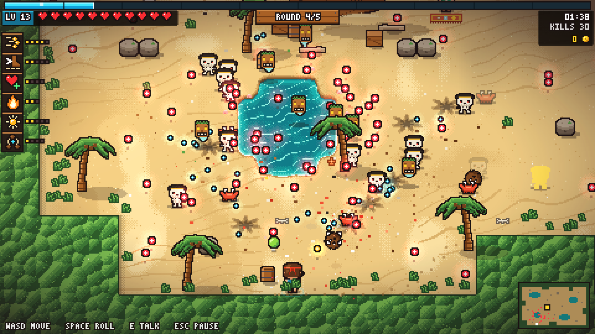

# [GAME TITLE] — island survival roguelike

*Working title.* A browser-based, top-down pixel-art roguelike: a group of castaways
washes up on a tropical island, survives waves of crabs, coconuts, skeleton pirates and
tiki spirits, levels up, sabotages each other with curses, and finally fights for the
only seat on the rescue boat.

Project for the **Generative AI and Language Models** course (UPM, 2026/27). The game is
built with generative AI (Claude Code); the process is documented in
[`docs/prompt-log.md`](docs/prompt-log.md) and [`docs/changelog.md`](docs/changelog.md).



## Status

| Milestone | What | State |
|---|---|---|
| 1 | Project setup, pixel-perfect test arena, move / shoot / roll | ✅ done |
| 2 | Enemies, waves, rounds, XP gems, HUD (+ survivors-style auto-aim controls) | ✅ done |
| 3 | Level-up cards: 8 stackable abilities | ✅ done |
| 4 | Graphics upgrade: environment, Crab Emperor, hero | ✅ done |
| 5 | Multiplayer server and lobby | next |
| 6–12 | Curses, Gulag, final PvP, AI messages, AI skins, audio, deployment | planned |

Full plan: [`design/game-brief.md`](design/game-brief.md), section 9.

## Run it

New to this? Follow the step-by-step guide in [`HOW_TO_PLAY.txt`](HOW_TO_PLAY.txt)
(Windows, macOS, Linux, plus fixes for common problems).

You need **Node.js 18.18 or newer** ([nodejs.org](https://nodejs.org), LTS).

```bash
git clone https://github.com/brandocorti/GEN_AI.git
cd GEN_AI
npm install          # once
npm run dev          # then open http://localhost:5173
```

```bash
npm test             # unit tests (Vitest)
npm run smoke        # tests + production build into dist/
```

### Play online with friends (any network)

Install [`cloudflared`](https://developers.cloudflare.com/cloudflare-one/connections/connect-networks/downloads/)
once (macOS: `brew install cloudflared`, Windows: `winget install Cloudflare.cloudflared`). No account needed.

```bash
npm run online       # starts server + client + tunnel, prints a public link
```

Send the printed `https://….trycloudflare.com` link to the others. Everyone opens it and picks
**Play online** in the start menu; one player creates a room and the rest join with the 4-letter code
(or the host shares the `?room=CODE` link, which opens the lobby directly).
Each player plays their own island: level-up cards and the salesman pause only your island, never
the others', so players can be in different rounds. Every island plays the whole run, up to its own Crab Emperor; a player who dies is out and the others play on. When every run is over, whoever beat the boss wins (if nobody did, whoever lasted longest). Your computer is the server, so keep it
awake and keep the terminal open. The link changes every time you restart.
On the same Wi-Fi you can skip the tunnel: run `npm run dev:all` and open the "Network" address Vite prints.

### Controls

| Key | Action |
|---|---|
| WASD / arrows | Move |
| E | Talk to the salesman (gold dot on the map) |
| Esc | Pause, settings |
| Space | Dodge roll (brief invulnerability, short cooldown) |
| — | Your slingshot fires **by itself** at the nearest enemy in sight |
| Mouse or 1 / 2 / 3 | Pick a card when you level up (the game pauses) |
| R / M | After the run: play again / menu |
| F9 (dev) | Save a screenshot to `production/qa/evidence/` |

### Dev shortcuts (add to the URL; they skip the start menu)

| Option | Effect |
|---|---|
| `?fast` | 100 s match (20 s rounds) instead of 5 minutes |
| `?round=3` | Start at round 3 |
| `?boss` | Go straight to the final boss |
| `?tough` | 10 hearts instead of 3 |
| `?cards=5` | Start with 5 cards to pick |
| `?classic` | The old graphics, for comparison |
| `?seed=42` | Same enemy spawns every run |
| `?online` | Open the online lobby instead (`?online&fast` makes a 100 s online match) |
| `?bots=2` | Online: add 2 test bots when you create a room |

Example: <http://localhost:5173/?fast&round=3&tough> shows the Crab King within seconds.

## How the code is organised

```
src/shared/   game rules: pure JavaScript, no Phaser (runs in the browser now, on the server later)
  config.js     every tuning value (speeds, enemy stats, rounds, XP curve)
  sim/          the simulation: world.js runs one fixed 60 Hz tick
  content/      enemies, abilities and arenas
src/client/   Phaser: scenes, sprites, HUD, effects, input
tests/unit/   Vitest tests for the rules
design/       game brief (the design record)
docs/         prompt log, changelog
.claude/      Claude Code Game Studios framework (agents, skills, hooks)
```

Developer guide (how to add an enemy, a tile, an arena, a rule): [`src/README.md`](src/README.md).

## Working on it as a team

1. Pull, then `npm install` (dependencies may have changed).
2. Run `npm run smoke` before you push: tests and build must pass.
3. Write a `docs/changelog.md` entry for every substantial change, and a
   `docs/prompt-log.md` entry for every meaningful prompt. Rules: [`CLAUDE.md`](CLAUDE.md), section 5.
4. Never commit API keys (`.env` is git-ignored).

Using Claude Code? Start it in the repo root so the team rules (`CLAUDE.md`) and the
framework in `.claude/` load. The milestones are driven with `/next` (see the brief).

## Credits and licences

- Game code: MIT, see [`LICENSE`](LICENSE).
- [Claude Code Game Studios](https://github.com/Donchitos/Claude-Code-Game-Studios) framework
  (`.claude/`, `CHANGELOG.md`, `UPGRADING.md`, `docs/`): MIT, see
  [`licenses/claude-code-game-studios.LICENSE`](licenses/claude-code-game-studios.LICENSE).
  Root `CHANGELOG.md` is the framework's; **ours is [`docs/changelog.md`](docs/changelog.md)**.
- [Phaser 3](https://phaser.io) (MIT). All art so far is placeholder pixel art drawn in code.
- Music: generated with AI, see [`assets/audio/README.md`](assets/audio/README.md).
