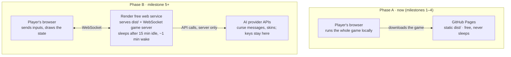

# Deployment Plan: Claw Survival

Last updated: 2026-11-25

How to put the game online, step by step. **Phase A (now):** GitHub Pages. **Phase B (from milestone 5):** Render. Both are free. After the one-time setup, publishing a new version is just a push to `main`.



In Phase A the browser only downloads files; in Phase B it keeps a live connection to our server, which is the only part that talks to the AI providers.

## Phase A: one-time setup (GitHub Pages)

### Step 1. Enable Pages (repo owner: brandocorti)

The repo is private and the rest of us only have write access, so only the owner can do this step.

1. Make Pages available on the repo. Pick one:
   - **Make the repo public:** Settings → General → Danger Zone → Change visibility → Public. This also gives the professors access to the code for the Moodle PDF.
   - **Keep it private:** get GitHub Pro free with the [GitHub Student Developer Pack](https://education.github.com/pack). The game site itself is public either way.
2. Settings → Pages → Build and deployment → Source: **GitHub Actions**.

### Step 2. Change the build config (any teammate)

In `vite.config.js`, add `base: './'` as the first line inside `defineConfig`. Without it the page loads blank on GitHub Pages.

```js
export default defineConfig({
  base: './', // relative paths, so the game works at brandocorti.github.io/Claw-Survival/
  root: path.join(repoRoot, 'src', 'client'),
  // ...the rest stays the same
});
```

Check it locally: run `npm run build`, then `npm run preview`, and open `http://localhost:4173`. The game must load.

### Step 3. Add the deploy workflow (any teammate)

Create the file `.github/workflows/deploy.yml` with exactly this content:

```yaml
name: Deploy to GitHub Pages

on:
  push:
    branches: [main]
  workflow_dispatch:

permissions:
  contents: read
  pages: write
  id-token: write

concurrency:
  group: pages
  cancel-in-progress: true

jobs:
  deploy:
    runs-on: ubuntu-latest
    environment:
      name: github-pages
      url: ${{ steps.deployment.outputs.page_url }}
    steps:
      - uses: actions/checkout@v4
      - uses: actions/setup-node@v4
        with:
          node-version: 22
          cache: npm
      - run: npm ci
      - run: npm run smoke
      - uses: actions/configure-pages@v5
      - uses: actions/upload-pages-artifact@v3
        with:
          path: dist
      - id: deployment
        uses: actions/deploy-pages@v4
```

It runs the tests and the build (`npm run smoke`) and only publishes if both pass.

### Step 4. First deploy

1. Add an entry to `docs/changelog.md`, then commit and push:

   ```bash
   git add vite.config.js .github/workflows/deploy.yml docs/changelog.md
   git commit -m "feat: deploy to GitHub Pages"
   git push origin main
   ```

2. On GitHub, open the **Actions** tab and wait for the "Deploy to GitHub Pages" run to show a green tick (about 2 minutes).
3. Open **https://brandocorti.github.io/Claw-Survival/** and play.
4. Put that link in `README.md` and in the Moodle PDF.

## Phase A: publish a new version

1. Run `npm run smoke` locally. It must pass.
2. Commit and `git push origin main`, or merge a pull request into `main`.
3. Wait for the green tick in the **Actions** tab.
4. Open the site and press **Ctrl+F5** to skip the browser cache.

**If the run is red:** click it and open the failed step to see the error. It is usually a failing test. Fix it and push again; the site keeps the last good version meanwhile. To redeploy without a new commit: Actions → Deploy to GitHub Pages → **Run workflow**.

## Phase B: move to Render (milestone 5+)

### Step 1. What the server must do

The milestone 5 `server.js` must:

- listen on the port in `process.env.PORT` (Render sets it), on host `0.0.0.0`
- serve the files in `dist/` for normal page requests
- run the WebSocket game server on that same HTTP server, so everything uses one URL
- read AI keys only from environment variables (`process.env`), never from a file in git

Also add `"start": "node server.js"` to the `scripts` in `package.json`.

### Step 2. Create the service (repo owner: brandocorti)

The owner does this because Render must read the private repo.

1. Sign up at [render.com](https://render.com) with the GitHub account. The free tier needs no card.
2. **New → Web Service**, connect GitHub and give Render access to `brandocorti/Claw-Survival`.
3. Fill in the form:

   | Field | Value |
   | --- | --- |
   | Name | `claw-survival` |
   | Region | Frankfurt (EU Central) |
   | Branch | `main` |
   | Language | Node |
   | Build Command | `npm ci && npm run build` |
   | Start Command | `npm start` |
   | Instance Type | Free |

4. Under **Environment Variables**, add `NODE_VERSION` = `22`, and one variable per AI key the server reads.
5. Click **Create Web Service**. The first build takes a few minutes; follow it in the **Logs** tab. The game's URL is shown at the top of the service page.

### Step 3. Switch over

1. Delete `.github/workflows/deploy.yml` so GitHub Pages stops publishing the old single-player version.
2. Replace the GitHub Pages link with the Render URL in `README.md`, `docs/changelog.md` and the Moodle PDF.

## Phase B: publish a new version

1. Run `npm run smoke` locally, then push to `main`.
2. Render deploys automatically. Wait until the **Events** tab shows "Deploy live".
3. If the build fails, Render keeps the previous version running. Check the **Logs** tab, fix, push again.

A deploy restarts the server and ends any live match, so never deploy while people are playing. On the free tier the server sleeps after 15 minutes without players and takes about 1 minute to wake.

## Presentation day

- [ ] Open the Render URL 2 minutes before our slot so it is awake
- [ ] A laptop with `npm run dev` tested, as a local fallback
- [ ] The recorded demo video, ready to play offline
- [ ] No pushes to `main` the day before or during the presentation
